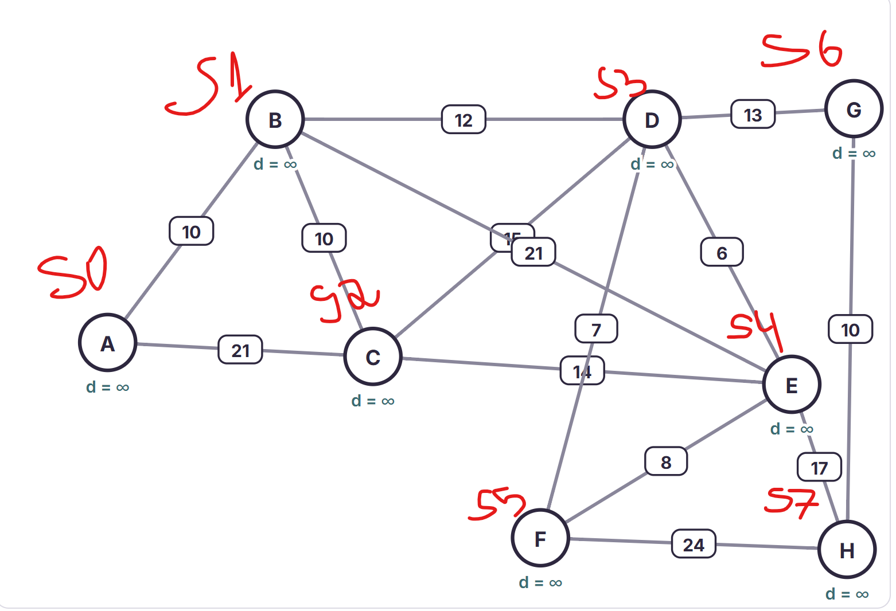
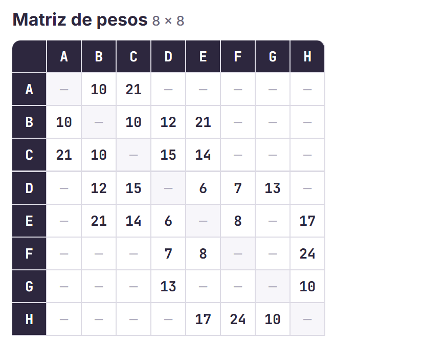
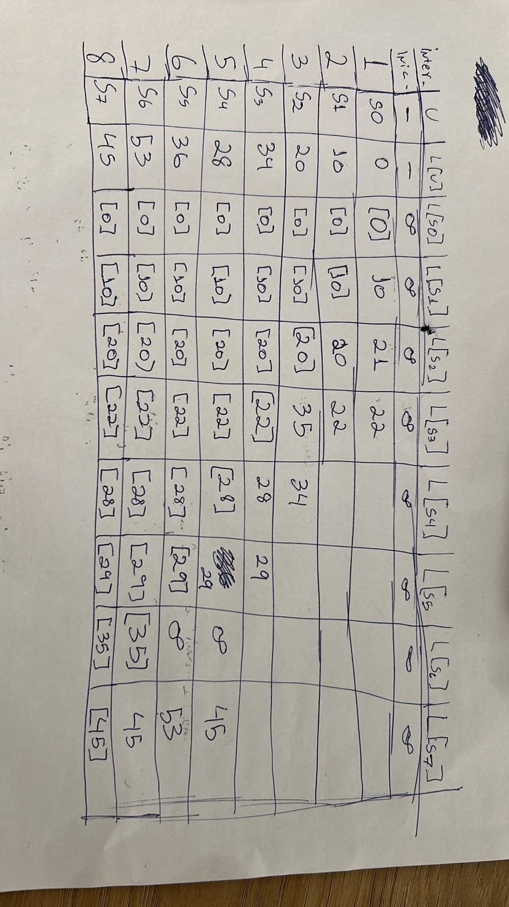
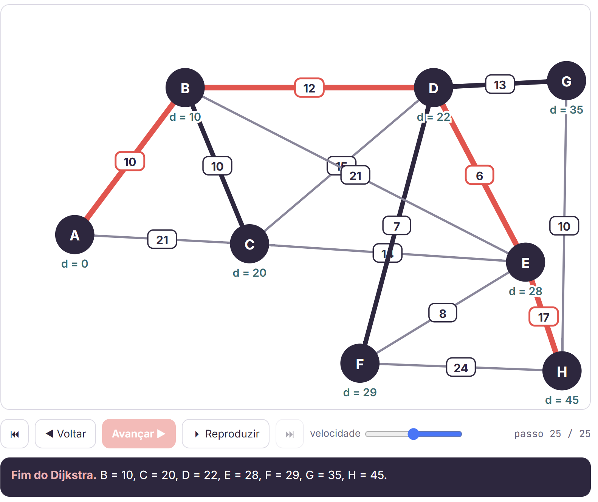
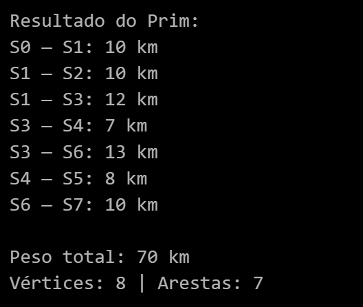
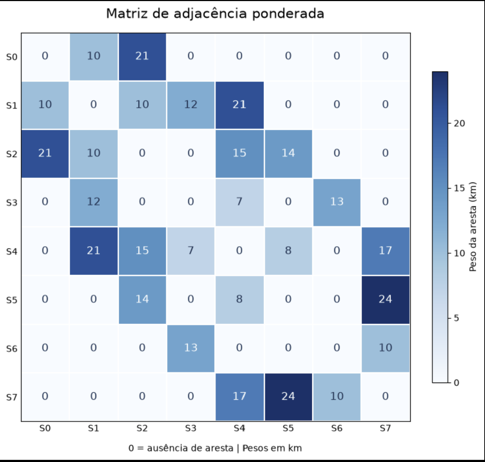

# Ponderada Murilo Smart Grid

## RA: A2025.1A.0265

## Etapa 1

### Parametrização pelo seu RA: 

Números utilizados do RA: 510265

D1 = 5, D2 = 1, D3 = 0, D4 = 2, D5 = 6, D6 = 5

Pesos:

| Aresta Ramal | Fórmula do peso w(e) | RA 510265 |
| --- | --- | --- |
| e1 (S0, S1) | w1 = 10 + (D6 mod 5) | 10 + (5 mod 5) = 10 km |
| e2 (S0, S2) | w2 = 15 + (D5 mod 7) | 15 + (6 mod 7) = 21 km |
| e3 (S1, S2) | w3 = 8 + (D4 mod 4) | 8 + (2 mod 4) = 10 km |
| e4 (S1, S3) | w4 = 12 + (D3 mod 6) | 12 + (0 mod 6) = 12 km |
| e5 (S2, S4) | w5 = 14 + (D2 mod 5) | 14 + (1 mod 5) = 15 km |
| e6 (S2, S5) | w6 = 9 + (D1 mod 6) | 9 + (5 mod 6) = 14 km |
| e7 (S3, S4) | w7 = 7 + ((D5 + D6) mod 5) | 7 + (10 mod 5) = 7 km |
| e8 (S3, S6) | w8 = 11 + ((D4 + D5) mod 6) | 11 + (8 mod 6) = 13 km |
| e9 (S4, S5) | w9 = 6 + ((D3 + D4) mod 4) | 6 + (2 mod 4) = 8 km |
| e10 (S4, S7) | w10 = 16 + ((D2 + D3) mod 7) | 16 + (1 mod 7) = 17 km |
| e11 (S5, S7) | w11 = 18 + ((D1 + D2) mod 8) | 18 + (6 mod 8) = 24 km |
| e12 (S6, S7) | w12 = 9 + ((D5 + D1) mod 5) | 9 + (7 mod 5) = 10 km |
| e12 (S1, S4) | w13 = 20 + (D6 mod 4) | 20 + (5 mod 4) = 21 km |

###  Diagrama topológico:

### Matriz 8x8

## Etapa 2

Obs: Eu fiz primeiro a mesa tabular no papel, e dpois rodei a simulação para ver se os resultados batiam, e deu tudo certo.

## Etapa 3

### 3.2 ALgoritmo de Dijkstra e Confronto entre código e mesa:

Usando a pagina de docs do networkx eu consegui utilizar através do exemplo, a forma de aplicação do algoritimo de Dijkstra, aí troquei pelos meus pesos e meus vértices e acabei tendo apenas um resultado diferente, que foi no S5, onde na mesa tabular que eu fiz e no html da aula do professor Murilo deu 29 o caminho mais curto, mas no meu notebook deu 34 como resultdo pro S5, o mesmo aconteceu com S4 que no notebook deu 29 e na mesa tabular e na simulação do html deu 28 km.

## 3.3 Evidências de console:

### 3.3.1 Algoritmo de Prim: 
Fiz utilizando a docs do network de minimum_spanning_tree que me auxiliou a fazer o algoritimo de prim.

### 3.3.2 Plot da matriz de adjacência:

## Etapa 4

Observação: na revisão final, percebi que o ramal (S3, S4) deveria ter 8 km pela fórmula do RA, mas usei 7 km no código. Mantive os pesos usados no notebook nas respostas abaixo para comparar com os resultados já apresentados.

### Questão 1 - Rota e custo ótimo

Como D6 = 5 é ímpar, meu destino é S6. A menor rota foi S0 → S1 → S3 → S6, com 10 + 12 + 13 = 35 km. Até chegar ao destino, Dijkstra fechou os vértices na ordem S0, S1, S2, S3, S4, S5 e S6. Continuando até o fim, S7 é fechado por último.

### Questão 2 - Contingência no ramal (S2, S4)

Ao remover o ramal (S2, S4), a melhor rota continuou sendo S0 → S1 → S3 → S6, com 35 km, pois ela não utiliza a conexão removida. Assim, o acréscimo foi de 0 km, equivalente a 0%.

### Questão 3 - Prim de Minimun Spanning Tree(MST) e Dijkstra

Prim conectou as 8 subestações com 7 arestas e custo total de 70 km. A soma das distâncias de Dijkstra a partir de S0 foi 195 km, mas ela conta os trechos compartilhados várias vezes. Contando cada aresta uma vez, a união dessas rotas custa 76 km. Ela não gera a MST neste caso porque Dijkstra busca os menores caminhos desde S0, enquanto Prim busca o menor custo total para conectar a rede. Por exemplo, Dijkstra liga S5 por S2, com uma aresta de 14 km, e Prim usa a ligação por S4, de 8 km, economizando 6 km na infraestrutura.
